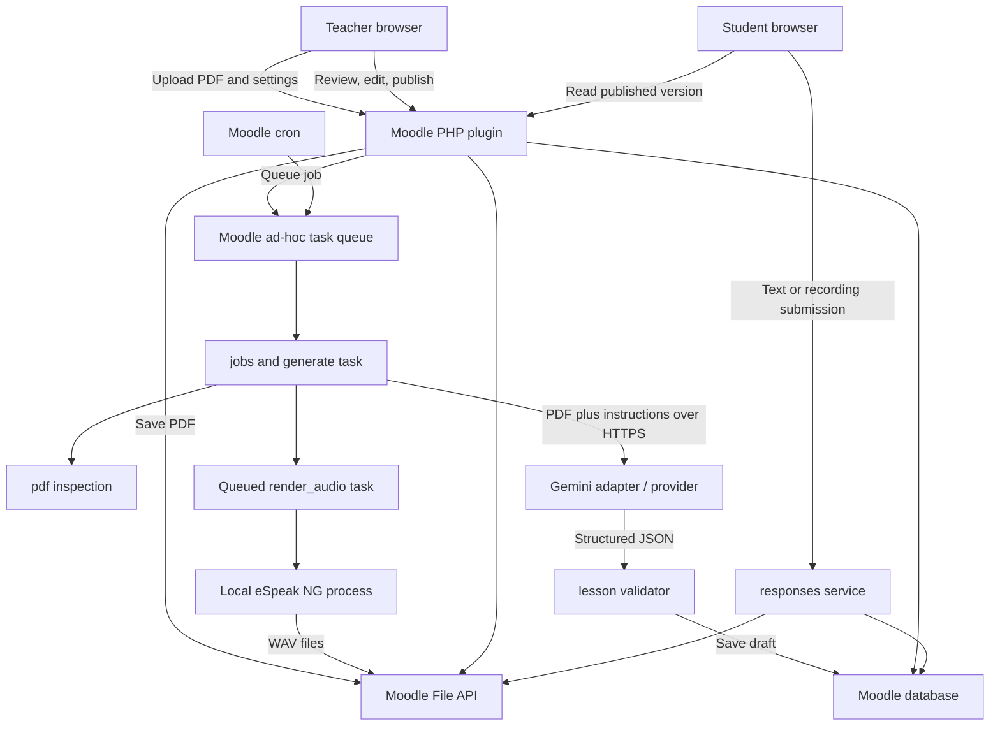

# Current 0.3.0 architecture additions

- `jobs::direct()` chooses direct versus background processing. In direct mode `action.php` queues only a database job record and immediately executes it, with the Moodle session lock released. Background mode retains ad-hoc task dispatch.
- `pdf::inspect()` returns a nullable page count: absent Poppler permits basic-check processing unless strict mode is enabled.
- `gemini::speech()` uses the official Interactions REST endpoint to return WAV data. It shares the saved key, eligibility requirements and daily request reservation with generation.
- `audio::render()` caches each missing section, supports local/cloud providers and one-section processing. `audio::upload()` accepts teacher MP3/WAV files on drafts under the same lesson lock. `audio::file()` finds either extension.
- `prepareaudio.php` and `amd/src/prepareaudio.js` perform sequential, authenticated teacher POST requests. Closing the page stops further requests; completed media remains cached. Students have no access to this worker.
- No new database tables were needed. `audiostatus` now includes safe failure codes. The student reader, File API permissions and backup mapping continue to use saved media.

> **0.3.0 update:** Read [the current upgrade and testing guide](UPGRADE-0.3.0.md) first. The original 0.2.0 details below describe the earlier background/local-speech design. The current release adds optional PDF inspection, direct processing, cloud speech, audio uploads and a native key input.

# How AI English Lessons works

The plugin runs inside Moodle. There is no separate application server and no AI conversation running for students. Teachers prepare and publish content; students read and submit work against the saved version.

## The technologies and what each does

| Technology/tool | Purpose |
| --- | --- |
| PHP | Server-side plugin logic, permissions, validation and Moodle integration |
| Moodle 4.4 APIs | Login, roles, forms, database access, files, background jobs, locks, backup, privacy and completion |
| MariaDB | Local storage for activity settings, lesson versions, job states, responses and progress; plugin code uses Moodle's database API |
| JSON | Structured lesson document exchanged with the AI and stored in a version record |
| Gemini REST API | Teacher-triggered PDF-to-lesson generation when enabled; no SDK required |
| Moodle curl wrapper | HTTPS requests from the server to the AI provider |
| Poppler `pdfinfo` | Checks the uploaded PDF's structure, encryption and page count; it does not generate the lesson |
| eSpeak NG | Turns approved draft scripts into local WAV files without an external speech API |
| Mustache + HTML + CSS | Escaped lesson templates, navigation, cards and responsive layout |
| JavaScript AMD module | Moodle-loaded speaking recorder and local preview |
| Browser MediaRecorder/getUserMedia | Captures microphone audio after permission; regular form submission uploads it |
| Docker Compose | Runs the local web server, database and cron services; not required if a Moodle server already exists |
| Git | Saves source-code checkpoints |
| Python and PHP test scripts | Create fictional fixtures, exercise Moodle HTTP/API behavior, package ZIPs and verify backups |

Docker's web container runs Apache/PHP. The cron container runs Moodle's task scheduler against the same code, database and file storage. Moodle core lives in a Docker volume to avoid slow Windows/OneDrive file scans. The plugin folder is mounted from this workspace so edits are immediately available locally.

## Communication flow

PHP classes communicate using ordinary method calls. Background work communicates through Moodle task records containing IDs. Audio processing communicates with a local executable. Only the Gemini adapter communicates with an external AI service, and only for administrator connection testing or teacher generation.

## What a class means here

A class groups related operations. A method is one operation belonging to a class. An interface defines operations that implementations must supply. Moodle automatically loads a namespaced class from its matching file under `classes/` when the code first uses it.

For example, `\mod_aienglishlesson\local\audio::queue($versionid)` asks the audio class to queue work for one saved version. It does not immediately run speech synthesis in the teacher's browser request.

## Classes and responsibilities

Paths below are relative to `aienglishlesson/`. Most namespaces begin with `mod_aienglishlesson`.

| Class/interface | File | Responsibility |
| --- | --- | --- |
| `local\provider` (interface) | `classes/local/provider.php` | Contract: `test()` and `generate(activity, pdf)`. Lets orchestration work with a real adapter or a fictional test adapter |
| `local\gemini` | `classes/local/gemini.php` | Implements provider; validates configuration, reserves request allowance, sends HTTPS requests and parses results |
| `local\provider_error` | `classes/local/provider_error.php` | Safe diagnostic code and whether failure is temporary |
| `local\pdf` | `classes/local/pdf.php` | Inspects PDFs and validates size/pages/range |
| `local\lesson` | `classes/local/lesson.php` | Defines JSON schema, validates sections and strips teacher keys/early feedback from student data |
| `local\jobs` | `classes/local/jobs.php` | Queues and runs generation, prevents duplicate active jobs, tracks attempts and saves drafts |
| `task\generate` | `classes/task/generate.php` | Moodle ad-hoc task entry point; passes a saved job ID to `jobs::run()` |
| `local\audio` | `classes/local/audio.php` | Queues synthesis, runs eSpeak NG, stores WAV files and checks publication readiness |
| `task\render_audio` | `classes/task/render_audio.php` | Moodle ad-hoc entry point for a version's audio |
| `local\responses` | `classes/local/responses.php` | Validates and saves learner text/audio, replaces recordings and deletes response files |
| `form\edit` | `classes/form/edit.php` | Teacher's Moodle draft-edit form |
| `admin_setting_apikey` | `classes/admin_setting_apikey.php` | Write-only key setting; blank preserves the key, `-` clears it |
| `privacy\provider` | `classes/privacy/provider.php` | Declares data, locates users/contexts, exports work and deletes approved learner data |
| `mod_aienglishlesson_mod_form` | `mod_form.php` | Native add/update activity form |
| `backup_aienglishlesson_activity_task` | `backup/moodle2/backup_aienglishlesson_activity_task.class.php` | Registers the activity's backup steps |
| `backup_aienglishlesson_activity_structure_step` | `backup/moodle2/backup_aienglishlesson_stepslib.php` | Defines backup records, relationships and files |
| `restore_aienglishlesson_activity_task` | `backup/moodle2/restore_aienglishlesson_activity_task.class.php` | Registers restoration steps |
| `restore_aienglishlesson_activity_structure_step` | `backup/moodle2/restore_aienglishlesson_stepslib.php` | Restores records/files and maps old IDs to new Moodle IDs |

The two `provider` classes are different: `local\provider` is the AI interface, while `privacy\provider` is Moodle's privacy implementation.

## Page entry points and supporting files

- `view.php`: reads the chosen version, checks access and prepares data for the lesson template.
- `action.php`: handles POST actions such as generate, build audio, publish, submit response and mark progress. Checks login, permissions and Moodle session tokens.
- `edit.php`: loads the draft editor, validates edits and invalidates old audio after changes.
- `responses.php`: teacher-only submission report with text and recording playback.
- `testconnection.php`: administrator-only provider metadata check.
- `index.php`: lists course activities.
- `lib.php`: Moodle callbacks for activity lifecycle, supported features and protected file delivery.
- `settings.php`: administrator settings; `db/access.php`: capability definitions.
- `db/install.xml`: fresh-install table definitions; `db/upgrade.php`: upgrades earlier plugin data.
- `version.php`: component, release and required Moodle version.
- `templates/lesson.mustache` and `styles.css`: student/teacher lesson presentation.
- `amd/src/recorder.js`: recorder source; `amd/build/recorder.min.js`: named AMD module distributed with the plugin. The built file is currently readable, not compressed.
- `lang/en/aienglishlesson.php`: English interface strings.

## Database and file storage

| Table | Stores |
| --- | --- |
| `aienglishlesson` | One activity's settings and course relationship |
| `aiel_versions` | Draft/published JSON documents and audio status |
| `aiel_jobs` | Generation status, attempts and safe diagnostics |
| `aiel_progress` | Completed sections per learner and version |
| `aiel_responses` | Written response per learner, version and section |
| `aiel_usage` | Request timestamps for the rolling provider limit |

Actual table names have the site's Moodle prefix, such as `mdl_`. API settings live in Moodle's configuration storage rather than these lesson tables.

Binary files live in Moodle's File API, not in the plugin directory. The `source` file area holds the teacher PDF, `audio` holds version-specific WAV files, and `recording` holds response-specific learner uploads. Moodle stores the file bytes and metadata; the plugin's file callback decides whether a requester may receive them.

## A generation, step by step

1. The teacher saves settings and a PDF using Moodle forms/File API.
2. Generate posts to `action.php`; `jobs::queue()` creates a job and an ad-hoc task.
3. Cron executes `task\generate`, which calls `jobs::run()`.
4. The Gemini adapter inspects the PDF, checks settings/limits and sends PDF bytes plus instructions to the fixed provider endpoint. A page range scopes the prompt; the entire PDF is still transmitted.
5. `lesson::validate()` checks the returned JSON. It requires all ten section types, including all four skills, within 10-20 sections. Unknown fields and oversized content are rejected.
6. Valid content becomes a new draft. A separate audio task creates WAV files from its scripts.
7. The teacher reviews accuracy and suitability. Structural validation is not a guarantee of factual or pedagogical quality.
8. Editing a draft removes its old audio; the teacher rebuilds it before publishing. Publication checks skill practice and listening media. The previous publication stays available until the replacement is published.

Temporary provider failures can retry up to three attempts. Failures save safe local diagnostics, not raw provider responses or keys. Jobs use locks to reduce concurrent duplicate work. Audio has its own ready/failed state and can be rebuilt by the teacher.

## A student interaction, step by step

1. `view.php` checks login/capability and selects the published version.
2. Teacher answer fields are removed. Prepared feedback is withheld until that learner submits a response for that section.
3. Mustache renders escaped plain text. Help buttons reveal content already saved with the lesson.
4. Listening streams an existing WAV through Moodle's protected file route.
5. Speaking capture happens in the browser; stopping shows a local preview. Submitting sends the recording to Moodle, not to Gemini.
6. `responses::save()` validates the request and audio type/size, then stores the answer and file. The student sees saved model guidance; the system does not claim to assess the student's answer.
7. The teacher reviews submissions through `responses.php`. Another learner cannot access that recording.

## Boundaries of this release

This is an installable testing release. There is no student AI chat, personalised automatic marking, pronunciation scoring, gradebook scoring, or external speech service. The voice is basic local synthesis. UI language is English. Teacher review is essential.

The provider integration exists but has not been exercised with a real key. See `PROVIDER.md` before enabling the current Gemini adapter for a school-facing application. No real API generation or provider eligibility is implied by the fictional automated fixtures or sample backup.

`STATUS.md` records verification; `TESTING.md` gives the installation and manual acceptance steps. Developer scripts in `dev/` are not shipped as executable plugin code in the installation ZIP.
